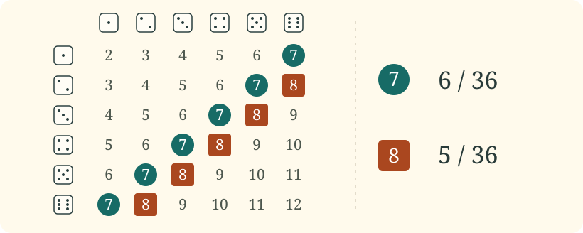

# Hermes Teacher

[简体中文](README.zh-CN.md)

Turn a question into a lesson you can come back to. Hermes Teacher asks what you already know, agrees on a plan with you, and gives you time to try an answer. Your explanations, sketches and unfinished questions live in a local Markdown vault.

## A minute in class

> **You** · I know how to add two dice. I still don't see why seven comes up more often than eight.
>
> **Teacher** · Let's give one die to you and one to me. You rolled a 1. What would I need to roll to make seven? And to make eight?
>
> **You** · A 6 for seven. For eight I'd need … a 7. Oh.
>
> **Teacher** · Exactly. Now try starting with a 2. Which totals are possible this time?

Here's the sketch for that conversation. Pick a die on the left and follow its row. Every square is one equally likely roll of two fair dice.



In a real lesson you can ask for a sketch, bring a passage you're stuck on, or say “I don't know.” A quiz keeps its explanation private until you answer. The teacher waits for you to continue after feedback.

## Start your first lesson

Install [Hermes Agent](https://hermes-agent.nousresearch.com/docs/) and make your model provider's credentials available to it. Teacher was exercised with Hermes Agent **v0.23.2** and Hermes Desktop **v0.23.3**. In the commands below, replace `YOUR_PROVIDER` and `YOUR_MODEL` with the identifiers for your own Hermes model.

```sh
git clone https://github.com/M1racleShih/hermes-teacher.git
cd hermes-teacher

bin/hermes-teacher init --vault "$HOME/Teacher Notes" \
  --provider YOUR_PROVIDER --model YOUR_MODEL
bin/hermes-teacher chat --topic "Why seven wins"
```

This creates a dedicated profile at `~/.hermes/profiles/teacher`. It must be empty on first use. For a custom provider defined in your existing Hermes config, add `--source-profile "$HOME/.hermes"` to `init` to import the endpoint and credential variable name. If the launcher cannot locate Hermes, set `HERMES_TEACHER_PYTHON` to its Python interpreter.

The classroom interface starts in English. Pass `--language zh` to `init` for Chinese. Existing Chinese profiles keep their language. To change an existing profile, set `teacher.language` to `en` or `zh` in its `config.yaml` and reopen the client. Ask your teacher to explain a subject in the language you prefer.

## Make yourself at home

| In class | What to do |
| --- | --- |
| Leave and come back | Type `/quit`. Next time, run `bin/hermes-teacher chat --resume` to reopen your notes and pending question. |
| Pick an answer | In the Teacher terminal, press Tab, choose with the arrow keys and submit with Enter. In a text chat, send an option letter. |
| Bring your own material | Put a Markdown file under `materials/` in your vault. Tell the teacher its relative path and which paragraph you want to unpack. |
| Keep useful work | Use `/status` to find the active record. In the Teacher terminal, `/seal` closes the current note and `/organize` turns sealed notes into chapters and review cards. |
| Use Hermes Desktop | Open the Teacher profile and enable its Desktop plugin under **Skills & Tools**. Press **F2** or enter `/classroom` to select a lesson. |

The model receives the text and materials you submit. Research can contact external sources, specialist tasks can run in the background, and optional diagrams use local renderers. Teacher saves the vault, quiz state and transcripts on the machine that hosts your profile. The Feishu adapter has been tested with simulated events. Live Feishu delivery and the mobile app still await device testing.

## Contributing

The Python plugin lives in `teacher/`, the desktop and terminal views in `desktop/` and `tui/`, and the teaching guides in `skills/`. Run `python3 -m unittest discover -s tests -v` from this checkout. The tests create disposable classrooms.

To run the Desktop interaction tests, point `HERMES_DESKTOP_SOURCE` at a Hermes `apps/desktop` checkout with its dependencies installed, then run `node --test --test-isolation=none tests/desktop/quiz-plugin.test.mjs` using Node 24.

## Inspiration and license

Amos Blomqvist's **learn** showed how a teaching skill, a quiz, a drawing and a Markdown record can work together in a personal learning environment. That teaching approach inspired Hermes Teacher. The plugin and its teaching guides are implemented for Hermes Agent. [Explore the original project](https://github.com/amosblomqvist/learn).

Hermes Teacher is released under the [MIT License](LICENSE).
