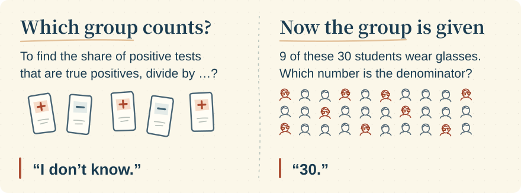
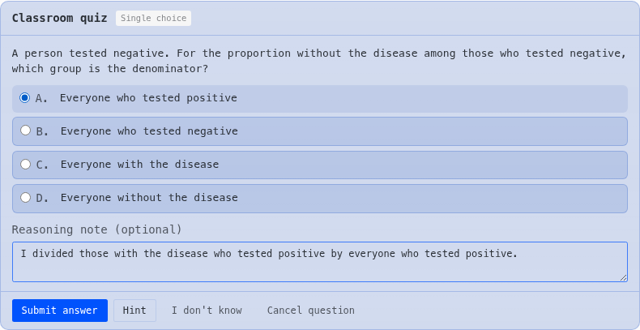

# Hermes Teacher

[简体中文](README.zh-CN.md) · [Start your first lesson](#start-your-first-lesson)

Hermes Teacher is a personal tutor for Hermes Agent. Bring a question you want to understand. A few short problems show your teacher where to begin. You get a map of the ideas you’ll need and can ask to change the order. At each key step, a fresh problem helps you and your teacher decide whether to move on or spend a little longer there.

## One goal, two learning paths

*If a test catches 99 out of every 100 people who have a disease, why doesn't a positive result mean a 99% chance of having it?*

Two simulated learners tackled that question with the same example data in Hermes Teacher. Their answers sent the lessons in different directions.

### Find the first missing step

Learner A knows percentages. But when asked which group belongs in the denominator after a positive test, they answer “I don’t know” and ask for a simpler question. Give them a class of 30 students, nine of whom wear glasses, and they pick the denominator straight away.



That pair of answers gives the teacher somewhere precise to start. A can use a denominator when the group is named. The part worth practising is how **“given a positive result” picks out a group**.

### See why your route starts here

A asks to study the two prerequisites separately. The revised plan shows how to identify the group being counted and how to turn test rates into numbers of people. A can see why both are needed to calculate the chance of disease after a positive result. They approve the plan and start by identifying the group.

Learner B already knows that the false-positive rate applies to people without the disease. They can find 5% of 200 by counting two groups of 100, but get stuck on **5% of 990**. B asks to try the calculations before seeing a worked answer. Their revised plan starts with the same trick. Split 990 into 1,000 minus 10, then try a table of 10,000 people so the counts come out whole.


### Try one step on a new case

Back in A’s lesson, the teacher explains one idea. “Given a positive result” means counting everyone who tested positive. Then comes a question about a different group. **Among people who tested negative**, what fraction are disease-free? A’s written reasoning still counts the *positive* tests.



*The question recreated in Hermes Desktop with sample data, just before submission.* [See the feedback after submission](assets/bayes-feedback.png).

The teacher saves a specific exercise for next time. A will name the group in a positive-result question, then try the negative case again. The arithmetic can wait. When A comes back, the local Markdown note preserves both the mistaken reasoning and the next question to try. [Read excerpts from the two lessons](examples/bayes-lessons.md).

## Start your first lesson

Install [Hermes Agent](https://hermes-agent.nousresearch.com/docs/) and configure a model provider. Replace `YOUR_PROVIDER` and `YOUR_MODEL` below with your Hermes provider and model. The classroom has been tested with Hermes Agent **v0.23.2** and Hermes Desktop **v0.23.3**.

```sh
git clone https://github.com/M1racleShih/hermes-teacher.git
cd hermes-teacher

bin/hermes-teacher init --vault "$HOME/Teacher Notes" \
  --provider YOUR_PROVIDER --model YOUR_MODEL
bin/hermes-teacher chat --topic "Understanding a positive test"
```

Give the teacher a goal in your own words. For example, *“I know percentages. I can follow the Bayes formula when someone writes it down, but I don’t know which numbers go where. Can we work through an example?”*

<details>
<summary>Profile, model provider and language</summary>

First-time setup creates a dedicated profile at `~/.hermes/profiles/teacher`. The target directory must be empty. For a custom provider in an existing Hermes config, pass `--source-profile "$HOME/.hermes"` to `init` to import the endpoint and credential variable name. If the launcher cannot locate Hermes, set `HERMES_TEACHER_PYTHON` to its Python interpreter.

New profiles start in English. Pass `--language zh` to `init` for Chinese. Existing Chinese profiles keep their language. To switch an existing profile, set `teacher.language` to `en` or `zh` in its `config.yaml` and reopen the client. You can ask the teacher to teach in your preferred language.

</details>

## Bring your material and keep your work

| In class | What to do |
| --- | --- |
| Work through a passage | Put a Markdown file in your vault’s `materials/` folder. Give the teacher the relative path and the passage you want to understand. You can ask it to check a source or draw a diagram along the way. |
| Answer a question | In the Teacher terminal, press Tab, choose with the arrow keys and submit with Enter. In text chat, send an option letter. You can add your reasoning or answer “I don’t know.” |
| Come back tomorrow | Use `/quit` to leave and `bin/hermes-teacher chat --resume` to reopen the lesson, including a pending question. |
| Review what you learned | Use `/status` to find the active Markdown record. In the Teacher terminal, `/seal` closes the note and `/organize` turns sealed records into chapters and review cards that you can open in Obsidian. |
| Open the classroom in Hermes Desktop | Open the Teacher profile and enable its Desktop plugin under **Skills & Tools**. Press **F2** or enter `/classroom` to pick a lesson. |

Your vault, transcripts and quiz state stay on the machine running your profile. The model receives the text and materials you submit. Research roles can consult outside sources, and diagram roles can use local renderers. The Feishu adapter has been tested with simulated events. Live Feishu delivery and the mobile app await device testing.

## Contributing

The Python plugin lives in `teacher/`, the desktop and terminal views in `desktop/` and `tui/`, and the teaching guides in `skills/`. Run `python3 -m unittest discover -s tests -v` from this checkout. The tests create disposable classrooms.

To run the Desktop interaction tests, point `HERMES_DESKTOP_SOURCE` at a Hermes `apps/desktop` checkout with its dependencies installed, then run `node --test --test-isolation=none tests/desktop/quiz-plugin.test.mjs` using Node 24.

## Inspiration and license

The teaching method draws on Eero Alvar’s *How I Use AI to Learn Things* and Amos Blomqvist’s **learn** project for Pi. Hermes Teacher brings that approach to Hermes Agent. [Probe prior knowledge · 9:55](https://www.youtube.com/watch?v=kzcI5F4tGiU&t=595s) · [Map the prerequisites · 12:34](https://www.youtube.com/watch?v=kzcI5F4tGiU&t=754s) · [Check a step · 14:24](https://www.youtube.com/watch?v=kzcI5F4tGiU&t=864s) · [Explore the original project](https://github.com/amosblomqvist/learn).

Hermes Teacher is released under the [MIT License](LICENSE).
