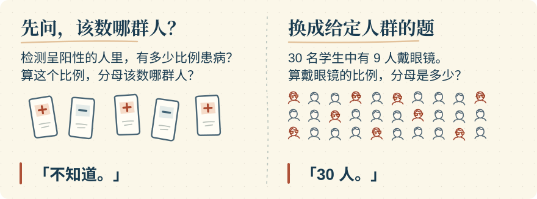
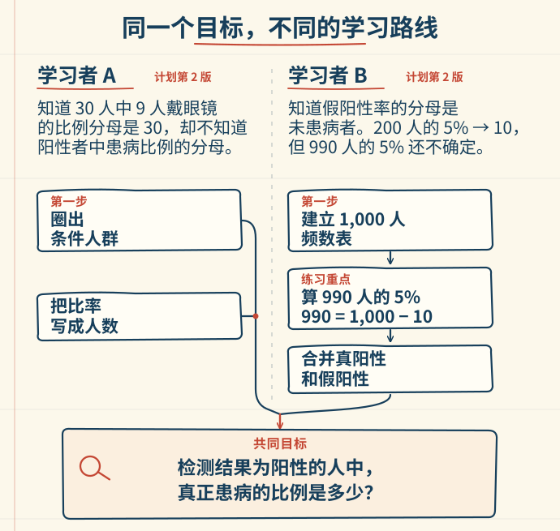
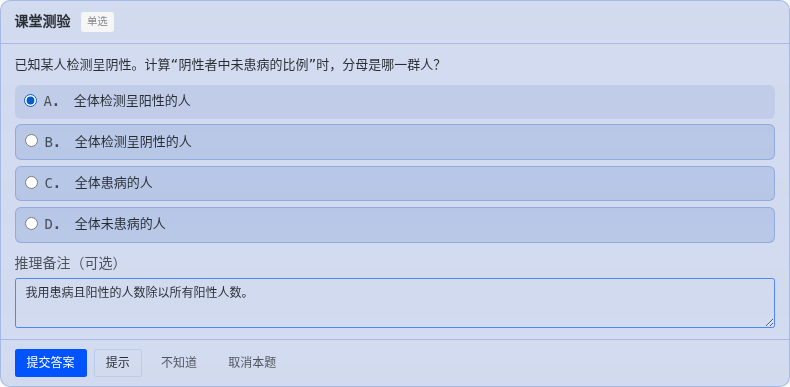

# Hermes Teacher

[English](README.md) · [开始第一节课](#开始第一节课)

Hermes Teacher 是 Hermes Agent 上的一对一老师。带来一个你想弄懂的问题，它会先用几道题找出你已经能独立做到哪一步，再画出适合你的学习路线。你能看到先补什么、为什么，也可以要求改顺序。每学到一个关键步骤，就换一道题试试，再决定往下走还是多练一遍。

## 同一个问题，两条学习路线

*一种检测能找出每 100 名患者中的 99 人。为什么我测出阳性，患病概率却未必是 99%？*

两位模拟学习者带着这个问题和同一份示例数据来上课。看看老师分别从哪里教起。

### 先用两道题找起点

学习者 A 会算百分比。问到「要算阳性者中患病的比例，分母该数哪群人」，A 答「不知道」，想先试一道简单的。换成班上 30 名学生、9 人戴眼镜，A 马上选出了分母。



两次回答放在一起，老师就有了开课的依据。人群明摆着时，A 知道该除以几。接下来值得练的是，怎样从**「已知检测为阳性」**这几个字里，自己圈出题目在说的那群人。

### 看懂为什么从这里教起

A 要求把两件事拆开学。老师改过的路线把「根据条件圈出人群」和「把百分比换成人数」分别列为前置，两步都会了，再计算阳性者中患病的比例。A 批准后，老师先教第一步。

学习者 B 能说清假阳性率算的是未患病者中的阳性比例。200 人的 5%，B 能按两个整百算出 10 人。换成 **990 人的 5%** 就卡住了。B 想在看到讲解前先自己算。老师改计划时便借用 B 已经会的凑整法，把 990 拆成 1,000 减 10，再让 B 试着把整张表放大到 10,000 人，这回每一格都是整数。



### 讲一步，换个情境再试一次

回到 A 的课。老师先带 A 看清「已知阳性」怎样把范围缩到所有阳性者。接着，老师把题里的条件换成**阴性**，问「阴性者中未患病的比例，分母该数谁」。A 写下的理由仍然在数**阳性**者。



*用示例数据在 Hermes Desktop 中复现，画面停在提交前。* [查看提交后的解析](assets/bayes-feedback.zh-CN.png)。

这句备注决定了下次从哪里接。老师把下一道练习写进本地 Markdown 续课说明，请 A 先指出阳性题说的是哪群人，再换回阴性题试一次。等 A 能跟着条件换对人群，再去算人数。[查看两节课的原文节选](examples/bayes-lessons.md)。

## 开始第一节课

先安装 [Hermes Agent](https://hermes-agent.nousresearch.com/docs/)，让它能使用你选择的模型服务。把下面的 `YOUR_PROVIDER` 和 `YOUR_MODEL` 换成你在 Hermes 中使用的服务名和模型名。项目已在 Hermes Agent **v0.23.2** 和 Hermes Desktop **v0.23.3** 上做过课堂验证。

```sh
git clone https://github.com/M1racleShih/hermes-teacher.git
cd hermes-teacher

bin/hermes-teacher init --vault "$HOME/学习笔记" --language zh \
  --provider YOUR_PROVIDER --model YOUR_MODEL
bin/hermes-teacher chat --topic "怎样理解阳性结果"
```

进教室后，说说你想弄懂什么。比如「我会算百分比，也能跟着别人写好的贝叶斯公式算一遍，但自己做题时不知道每个数该放在哪。能用一个例子带我学吗？」

<details>
<summary>专用配置、自定义模型服务和界面语言</summary>

首次初始化会在 `~/.hermes/profiles/teacher` 建立专用配置，目标目录须为空。如果使用已有 Hermes 配置中声明的自定义服务，在 `init` 后加 `--source-profile "$HOME/.hermes"`，即可导入服务地址和凭据环境变量名。启动器找不到 Hermes 时，可把 `HERMES_TEACHER_PYTHON` 设为 Hermes 的 Python 解释器路径。

新配置默认使用英文界面。示例里的 `--language zh` 会选择中文，旧中文课堂保留原语言。要给已有配置切换界面，在它的 `config.yaml` 中把 `teacher.language` 设为 `en` 或 `zh`，然后重新打开客户端。也可以在课堂中告诉老师你希望用哪种语言学习。

</details>

## 带上自己的材料，留下自己的笔记

| 我想做什么 | 可以这样做 |
| --- | --- |
| 读懂自己的材料 | 把 Markdown 文件放进资料库的 `materials/`，告诉老师相对路径和你卡住的段落。学到需要的地方，可以请老师核对出处或画图。 |
| 答题或写下想法 | 在 Teacher 命令行按 Tab，用方向键选择，按 Enter 提交。在文字聊天中直接发选项字母。你可以附上推理过程，也可以答「不知道」。 |
| 明天接着学 | 用 `/quit` 离开。下次运行 `bin/hermes-teacher chat --resume`，可以接着上原课，包括上次还没回答的题。 |
| 整理与复习 | 用 `/status` 找到当前 Markdown 记录。Teacher 命令行的 `/seal` 封存笔记，`/organize` 把封存记录整理成章节和复习卡，可以在 Obsidian 打开。 |
| 在 Hermes Desktop 上课 | 打开 Teacher 专用配置，在「技能与工具」启用桌面插件。按 **F2** 或输入 `/classroom` 即可选课。 |

资料库、课堂原文和测验状态保存在运行专用配置的机器上。你提交的文字和材料会交给所选模型。研究角色可以访问外部来源，绘图角色可以使用本机渲染器。飞书适配器已用合成事件验证，真实飞书投递和手机 App 体验仍待实机验证。

## 参与开发

Python 插件位于 `teacher/`，桌面和终端视图位于 `desktop/` 和 `tui/`，随插件安装的教学指南位于 `skills/`。在仓库根目录运行 `python3 -m unittest discover -s tests -v`，即可用临时课堂执行回归测试。

桌面交互测试使用 Node 24。将 `HERMES_DESKTOP_SOURCE` 设为已安装开发依赖的 Hermes `apps/desktop` 目录，然后运行 `node --test --test-isolation=none tests/desktop/quiz-plugin.test.mjs`。

## 灵感与许可

Hermes Teacher 的教学方法借鉴了 Eero Alvar 的视频《How I Use AI to Learn Things》和 Amos Blomqvist 的 Pi 项目 **learn**。Hermes Teacher 将这套方法带到 Hermes Agent。[用题目找起点 · 9:55](https://www.youtube.com/watch?v=kzcI5F4tGiU&t=595s) · [看依赖路线 · 12:34](https://www.youtube.com/watch?v=kzcI5F4tGiU&t=754s) · [检查一步推理 · 14:24](https://www.youtube.com/watch?v=kzcI5F4tGiU&t=864s) · [访问原项目](https://github.com/amosblomqvist/learn)。

Hermes Teacher 采用 [MIT 许可证](LICENSE)。
